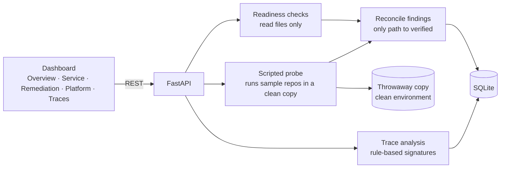

# AgentReady — Product Brief

> **One-line proposition:** Identify what prevents AI coding agents from completing work on enterprise repositories and services, assign each gap to the team that owns it, and prove with a rerun whether the fix actually helped.

> **Status:** Working prototype. Three fictional sample services run through the full loop in a FastAPI and SQLite application with a plain JavaScript dashboard, 14 automated tests and a reproducible recorded demo: assess → run the task → find the blocker → assign → fix → reassess. Task outcomes come from a deterministic scripted probe that really runs each sample repository's tests. **No real LLM agent has been run.** Failed agent traces are simulated fixtures, labelled in the product and excluded from task completion.

**Contents:** [Overview](#1-product-overview) · [Demo](#product-demo) · [Problem](#2-the-problem) · [Users](#3-target-users) · [Value](#4-value-proposition) · [Capabilities](#5-product-capabilities) · [Architecture](#6-product-architecture) · [Workflows](#7-user-workflows) · [Metrics](#8-success-metrics) · [Decisions](#9-product-decisions-and-trade-offs) · [Scope & limitations](#10-prototype-scope-and-limitations) · [What comes next](#11-what-comes-next)

Setup and run instructions are in [README.md](README.md).

---

## 1. Product Overview

As enterprises deploy more AI coding agents, the challenge is not only improving the agents. It is making sure the services and repositories they work on are ready for them, and identifying what engineering teams need to change when they are not.

**AgentReady** is not another coding agent. It makes existing repositories, services and engineering workflows easier for agents to use reliably. It assesses a service across eight readiness dimensions, tries a real task, finds the first thing that stops the task, assigns that gap to the owning team, and reruns the task after the fix.

```
Assess ──► Run the task ──► Find the blocker ──► Assign ──► Fix ──► Reassess
  ▲        (measured)        (with evidence)    (owning     (team)   (rerun, not
  │                                              team)                self-report)
  └───────────────────────────────────────────────────────────────────────┘
```

Each step produces the input the next one needs. The objective is not to raise a readiness score. It is to raise actual task completion.

| | |
|---|---|
| **Product** | AgentReady: AI Coding Agent Readiness Assessment Platform |
| **Primary users** | Service-owning engineering teams, the AI coding-agent platform team, engineering managers, engineers operating coding agents |
| **Secondary stakeholder** | Platform Product Manager |
| **Prototype** | FastAPI + SQLite backend, plain JavaScript dashboard, Playwright demo |
| **Sample services** | billing-service, notifications-service, identity-service (all fictional) |

**The finding that shapes the product.** In the reference run, notifications-service **completes** its task at a readiness score of **41**, while billing-service is still **blocked** at **97**. A score counts what a repository has. It cannot tell you what actually stops the work.

---

## Product Demo

[](https://arunks2804.github.io/agentready/)

**▶ [Watch the narrated demo (under 5 min, 1920×1080, with sound)](https://arunks2804.github.io/agentready/)** · [download the MP4](docs/demo/agentready-demo.mp4)

The demo is written so that someone outside the field, a senior executive for example, can follow it without prior knowledge. Plain-English slides come first. Each chapter then shows the real application with a visible pointer and zoom-ins on the evidence. All application footage is a live Playwright recording, and every number spoken or captioned is read from the page while it records. The British voiceover is AI-generated with Piper, which runs locally.

| Part | What it explains and shows |
|---|---|
| Opening | Why capable agents still fail; the new-starter comparison; how AgentReady works in six steps; the disclosure of what is simulated |
| 1 · Where we start | The live overview: **1 of 3 tasks complete**, and three services with very different scores |
| 2 · Finding the real blocker | billing-service scores 88, yet its task stops at one undocumented setting. The evidence and owning team are shown |
| 3 · A higher score is not proof | Two fixes raise the score to 97. The task stays blocked and the finding reopens |
| 4 · The fix that works | A working sample config. The score does not move, and the task completes |
| 5 · The leadership view | Recurring blockers, the readiness heatmap, and simulated traces kept separate |
| 6 · Blockers in layers | notifications-service: each fix reveals the next blocker, and the task completes at a score of 41 |
| Summary | Before and after, read from the live run |

Re-record it yourself: `python scripts/record_demo.py` (needs `requirements-demo.txt`, a Piper voice and ffmpeg; see the README).

---

## 2. The Problem

Enterprises are adopting AI coding agents for software development, debugging, unit testing, code review and issue resolution. These agents often struggle because a repository or service lacks the information, tools or environment needed to finish the task.

An agent assigned a bug fix might meet missing API documentation, unclear service dependencies, incomplete tests, an unavailable development environment, or too little debugging information. **The problem is not necessarily the agent.** The repository may simply not be ready for agent-assisted development.

Current practice fails in predictable ways:

- **The agent gets the blame.** A failed run reads as a model problem, so teams change models or prompts when the real gap is a missing config file.
- **Nobody owns the gap.** The team running the agent sees the failure. The team that can fix it owns a different service and never hears about it.
- **Checklists measure the wrong thing.** A readiness checklist records whether a document exists, not whether an agent can get its work done.
- **Fixes go unproven.** A ticket gets closed because someone added documentation. Nobody reruns the task to see whether it helped.
- **The same failure repeats.** Twenty services can hit the same blocker and the platform team only sees twenty unrelated incidents.

**Why a readiness score is not enough:** a score is a proxy. Improvement needs a closed loop in which a real task fails, the failure is tied to evidence, the owner fixes it, and the same task is run again. AgentReady makes that loop the product.

---

## 3. Target Users

An early draft treated the Platform Product Manager as the primary user. That was wrong. The people who act on a finding are the engineers who own the service and those who run the agents, so they are the primary users. The Platform PM uses the aggregate view.

### Persona 1 — Service-owning engineering team (primary)
*"Tell me what is stopping agents on my service, and prove it. Don't hand me another checklist."*

**Responsibilities:** owns the service, its documentation, test setup and configuration.

**Challenges:**
- Generic readiness advice with no evidence or priority.
- No way to know which gap actually stops work.

**How AgentReady helps:** findings arrive assigned, with the file, line or command output behind them. Only something that really stopped a task is ranked as a blocker.

### Persona 2 — AI coding-agent platform team (primary)
*"Is this failure ours, or the service's?"*

**Responsibilities:** runs agent infrastructure and is judged on whether agents succeed across the organisation.

**Challenges:**
- Failures are hard to separate into agent problems and repository problems.
- No route from a failed run to the team that can fix it.

**How AgentReady helps:** failed traces are matched to a likely cause and linked to the owner's finding, with measured runs kept separate from simulated ones.

### Persona 3 — Engineering manager (primary)
*"Which of this work is worth my team's time?"*

**Responsibilities:** prioritises team capacity and accounts for agent adoption.

**Challenges:**
- Readiness work competes with feature work, and its value is hard to show.

**How AgentReady helps:** a team queue ordered by severity, and verification that shows which fixes changed the outcome.

### Persona 4 — Engineer operating a coding agent (primary)
*"Before I point an agent at this service, will it work?"*

**Responsibilities:** assigns tasks to agents and reviews the output.

**Challenges:**
- Time lost to runs that were never going to succeed.

**How AgentReady helps:** the latest task result and known blocker are visible before a task is assigned.

### Secondary stakeholder — Platform Product Manager
*"Which blockers are worth solving once, for everybody?"*

Uses aggregate findings to see recurring blockers, prioritise investment and shape the platform roadmap.

---

## 4. Value Proposition

| Outcome | How AgentReady delivers it | Evidence in the prototype |
|---|---|---|
| **Find the real blocker** | Runs the task and stops at the first gap | billing-service's blocker is found at a score of 88, from the actual test output |
| **Reach the right owner** | Each finding goes to the owning team | Remediation is grouped by team |
| **Separate effort from effect** | A fix is verified only by a rerun | The name-only fix passes its static check and the finding still reopens |
| **See through the score** | Outcome and score are always shown separately | Blocked at 97; completed at 41 |
| **Solve problems once** | Aggregate view across services | Recurring blockers by dimension, with counts for services affected |

---

## 5. Product Capabilities

### Capability 1 — Repository and service registration
Three sample services are loaded on first run. A local repository can be registered with a name, owning team and path. Registered repositories get static checks only, because their code is never executed.

### Capability 2 — Readiness assessment across eight dimensions

| Dimension | What AgentReady evaluates |
|---|---|
| Discovery | Can the agent locate the correct service or repository? |
| Code understanding | Can it understand architecture, dependencies and conventions? |
| API context | Are API contracts, schemas and usage information available? |
| Build environment | Can it build and run the service? |
| Testing | Can it execute and interpret relevant tests? |
| Debugging and observability | Are logs, traces and error information sufficient? |
| Delivery workflow | Can it understand CI/CD checks and release requirements? |
| Task context | Does it have enough information to complete the task? |

The prototype applies 17 weighted checks that read files on disk. Each dimension is scored as the weighted share of passing checks, and the overall score is the mean of the eight.

### Capability 3 — Measured task runs
A scripted probe walks the path an agent would take: find the service, locate the code, read the API contract when the ticket needs it, find the test command, prepare a clean environment using only documented settings, apply the known correct change, and run the tests. It stops at the first gap. Runs use a throwaway copy with a 30-second limit.

### Capability 4 — Failed trace analysis
Failed agent traces are matched to a likely cause by rule-based signatures and linked to any existing finding. The step and quoted output that triggered the match are shown. Unmatched traces stay "Unclassified" rather than being guessed at.

### Capability 5 — Evidence-backed findings
Each finding has a dimension, severity, evidence and a recommended improvement. Evidence is labelled Measured or Simulated. Severity runs low, medium, high, with **blocker** reserved for what actually stopped a measured task.

### Capability 6 — Remediation and ownership
Findings go to the owning team and move through open, in remediation, awaiting verification, reopened and verified. Teams can start work and submit a fix.

### Capability 7 — Reassessment and verification
Reassessment repeats the static checks and the task. **It is the only way a finding becomes verified.** A finding stays open while its check fails, or while the measured task is blocked on it, even if the static check passes.

### Capability 8 — Dashboard and platform insights
The overview leads with task completion. Each service page shows the run step by step, its findings, and score and outcome over time. The platform view shows recurring blockers and a readiness heatmap.

---

## 6. Product Architecture



| Component | Responsibility |
|---|---|
| `app/checks.py` | The 17 static checks and scoring |
| `app/probe.py` | The scripted task run and the classification of its output |
| `app/traces.py` | Rule-based matching of failed traces to causes |
| `app/store.py` | Persistence, assessment workflow, finding lifecycle and metrics |
| `app/main.py` | REST API and static hosting |
| `static/` | Dashboard |

**Isolation.** Only bundled sample repositories are executed, in a temporary copy with a minimal environment and a time limit. Registered repositories are read and never run. Registration is limited to paths inside the user's home folder.

---

## 7. User Workflows

### Workflow 1 — Find out why an agent is stuck
A service owner opens the service, sees where the task stopped, reads the evidence, and sees the recommended change.

### Workflow 2 — Fix and prove it
The team starts remediation, makes the change and submits it. Reassessment reruns the task. The finding becomes verified, or reopens with the reason.

### Workflow 3 — Work through layered blockers
Fixing one blocker lets the task travel further and reveal the next. notifications-service moves from discovery to API context to testing before it completes.

### Workflow 4 — Plan platform investment
The Platform PM reviews recurring blockers across services to decide what to solve centrally, such as a shared environment template, instead of team by team.

---

## 8. Success Metrics

**Primary outcome: coding-agent task completion rate.** A higher readiness score alone does not demonstrate that an agent has become more effective.

| Metric | Reference run | Note |
|---|---|---|
| **Task completion rate** | 1 of 3 → **3 of 3** | Measured by the scripted probe on fictional, deliberately flawed services |
| Tasks blocked | 2 → 0 | Reduction in repeated failure categories at prototype scale |
| Successful completion after remediation | 2 of 2 blocked services | |
| Time to identify a blocker | Tens of milliseconds | Probe run time on tiny sample repositories |
| Time to remediate | Demo clock only | Real timestamps, but they say nothing about engineering time |
| Average readiness score | 65 → 78 | Supporting signal only |
| Findings verified / open | 7 / 12 | Reopened at least once: 1 |

The full per-step evidence is in [docs/examples/SUMMARY.md](docs/examples/SUMMARY.md). The three-service results illustrate the mechanism. They are not an estimate of real-world improvement.

---

## 9. Product Decisions and Trade-offs

| Decision | Chosen | Alternatives considered | Why |
|---|---|---|---|
| Primary metric | **Task completion** | Readiness score | A score can rise with no effect on work, which the demo shows directly |
| Primary user | **Service owners and agent operators** | Platform PM | Those users act on findings; the PM works from the aggregate view |
| Score and outcome | **Always shown apart, never blended** | One composite number | A blend would hide the exact gap the product exists to expose |
| Who verifies | **Only reassessment** | Team marks a ticket done | Self-reported fixes are the failure this product addresses |
| Blocker severity | **Only from a measured stop** | Fixed severity per check | Evidence should set priority, not a static rule |
| Probe design | **Deterministic script** | Real LLM agent in the prototype | Before-and-after must be reproducible and causal. An LLM's variability would blur that. It also means LLM results remain unmeasured |
| Probe stops at first gap | **Sequential** | Report all gaps at once | That is how a real task fails, and it shows the next most useful fix |
| Execution boundary | **Sample repos only** | Run any registered repo | Running unknown code needs real sandboxing, which the prototype lacks |
| Trace analysis | **Rule-based signatures** | LLM classification | Each match cites a step and quote, and unmatched traces stay unclassified |
| Simulated data | **Labelled, excluded from the primary metric** | Blend into results | A credible measure must never mix fixtures with observations |
| Storage | **SQLite** | Postgres | Zero-setup local reproduction |

---

## 10. Prototype Scope and Limitations

**Implemented and working:**
- All seven MVP items: registration, eight-dimension assessment, trace analysis, evidence-backed findings, assignment, dashboard and reassessment.
- 14 automated tests and a reproducible recorded demo.
- Exported evidence in `docs/examples/`.

**Simulated:**
- Failed agent traces are fixtures. They never count toward completion.
- Team fixes in the demo stand in for commits. The reassessment after them is real.

**Scripted:**
- The probe is not an AI. It applies a known correct change, so it tests whether the repository lets a task finish. It says nothing about an LLM's ability to write that change.

**Intentionally constructed:**
- The sample repositories, tickets and teams are fictional, and two services are deliberately flawed. Their failures are genuine test executions, not hard-coded results.
- The score of 41 and the blocked 97 follow from those constructed samples. They demonstrate that the two can diverge. They do not show how often that happens.

**Known limitations:**
- **Not validated on real repositories or real agents.** Whether fixing these gaps raises LLM completion rates is the central hypothesis, and it is untested.
- Registered repositories get static checks only, so their task outcome is "not measured".
- Traces link to existing findings and do not create new ones.
- Checks use file conventions and suit Python and common layouts best. Weights are judgement calls.
- The app has no authentication or tenant model, and should stay on localhost.
- The probe's three-repo sample is far too small to support statistical claims.

---

## 11. What Comes Next

1. **Test the central hypothesis.** Run a real coding agent on a fixed task set in real repositories, before and after remediation, and compare completion rates.
2. **Learn which checks predict completion.** Use those runs to replace judgement-based weights with evidence.
3. **Ingest real traces** from an agent platform, with findings created from them.
4. **Connect ownership systems:** service catalog, issue tracker and CI, so findings reach teams where they already work.
5. **Add real sandboxing** so tasks can run safely on any registered repository.
