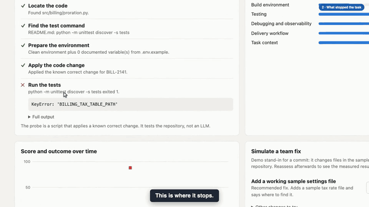

# AgentReady — Product Brief

> **One-line proposition:** Find out whether a service is ready for AI coding agents before stories are assigned to them, send each gap to the team that owns it, and prove the fix through reassessment and real coding outcomes.

> **Status:** Early local prototype. This brief describes the full product. What exists today is set out in [Prototype Scope and Limitations](#10-prototype-scope-and-limitations), and the demo's limits are in [Product Demo](#product-demo).

**Contents:** [Overview](#1-product-overview) · [Demo](#product-demo) · [Problem](#2-the-problem) · [Users](#3-target-users) · [Value](#4-value-proposition) · [Capabilities](#5-product-capabilities) · [Architecture](#6-product-architecture) · [Workflows](#7-user-workflows) · [Metrics](#8-success-metrics) · [Decisions](#9-product-decisions-and-trade-offs) · [Scope](#10-prototype-scope-and-limitations)

Setup and run instructions are in [README.md](README.md).

---

## 1. Product Overview

As enterprises adopt AI coding agents, the challenge is not only improving the agents. It is making sure the services they work on are ready for them.

**AgentReady** is not another coding agent. It is an AI Coding Agent Readiness Assessment Platform. It assesses a service before work is assigned, finds missing or misleading prerequisites, assigns each gap to the owning team, and validates readiness with controlled coding tasks. When agents later get stuck on ordinary work, the same capability diagnoses why, so readiness keeps improving.

| | |
|---|---|
| **Product** | AgentReady: AI Coding Agent Readiness Assessment Platform |
| **Primary value** | Proactive service readiness assessment, before AI coding tasks are assigned |
| **Users** | Service-owning engineering teams, the AI coding-agent platform team, engineering managers, engineers operating coding agents |
| **Operating model** | The platform team owns and runs AgentReady. Service teams use it for their own services |
| **Connects to** | Code repositories, CI, service catalog, issue trackers such as Jira, and coding-agent platforms |

---

## Product Demo

**▶ [Watch the narrated demo](https://arunks2804.github.io/agentready/)** · [download the MP4](docs/demo/agentready-demo.mp4)

The demo covers only the first assessment of one fictional service, Notifications Service. It is limited by what the prototype can do today:

- **Simulated:** Gap Analysis Agent results, Coding Agent results, and the team's fix, which is a prepared change. The team isn't informed in the demo.
- **Real:** the script checks, reassessment by those checks, and the file changes.

---

## 2. The Problem

Enterprises are adopting AI coding agents for development, debugging, unit testing, code review and issue resolution. These agents often struggle because a service lacks the information, tools or environment they need.

An agent assigned a story might meet missing API documentation, a contract that no longer matches the code, unclear dependencies, incomplete tests, an unavailable environment, or too little debugging information. **The problem is not necessarily the agent.** The service may simply not be ready for agent-assisted development.

Current practice fails in predictable ways:

- **Problems are found too late.** Teams learn a service isn't ready only after an agent has failed on real work.
- **The agent gets the blame.** A failed run reads as a model problem, so teams change models or prompts when the real gap is in the service.
- **Nobody owns the gap.** The team running the agent sees the failure. The team that can fix it never hears about it.
- **Checklists measure the wrong thing.** A checklist records that a document exists, not whether it is correct or usable.
- **Fixes go unproven.** A ticket closes because someone added documentation, and nobody checks that it helped.
- **The same failure repeats.** Twenty services can hit one blocker, and the platform team sees twenty unrelated incidents.

---

## 3. Target Users

AgentReady has four personas.

### Persona 1 — Service-owning engineering team
*"Tell me what is stopping agents on my service, and prove it. Don't hand me another checklist."*

**Responsibilities:** owns the service, its documentation, test setup and configuration.

**Challenges:** generic advice with no evidence or priority, and no way to know whether a fix helped.

**How AgentReady helps:** the team assesses its own service, is told about each gap, sees the evidence and recommended change, and gets proof when the fix works.

### Persona 2 — AI coding-agent platform team
*"Is this failure ours or the service's, and which problems are worth solving once for everybody?"*

**Responsibilities:** runs agent infrastructure and AgentReady, and is judged on whether agents succeed across the organisation.

**Challenges:** separating agent problems from service problems, reaching the right owner, and spotting recurring blockers.

**How AgentReady helps:** failures are diagnosed and routed to owners, and the platform view shows recurring gaps so that shared problems are solved centrally.

### Persona 3 — Engineering manager
*"Which of this work is worth my team's time?"*

**Responsibilities:** prioritises team capacity and accounts for agent adoption.

**Challenges:** readiness work competes with feature work, and its value is hard to show.

**How AgentReady helps:** a queue ordered by severity, and evidence of which fixes changed real outcomes.

### Persona 4 — Engineer operating a coding agent
*"Before I point an agent at this service, will it work?"*

**Responsibilities:** assigns work to agents and reviews the output.

**Challenges:** time and money lost on runs that were never going to succeed.

**How AgentReady helps:** readiness, known gaps and past task outcomes are visible before work is assigned, with a clear statement of what they cover.

---

## 4. Value Proposition

| Outcome | How AgentReady delivers it |
|---|---|
| **Find gaps before work is assigned** | Assesses each service across eight dimensions, ahead of real stories |
| **Catch what checklists miss** | Combines scripts with an agent that judges whether docs and contracts are correct |
| **Reach the right owner** | Each finding goes to the owning team with evidence and a recommended fix |
| **Prove the fix** | Findings close only through reassessment, never by self-report |
| **Measure what matters** | Readiness and coding-task success are reported separately |
| **Learn from later failures** | Failures feed the same gap analysis, and repeatable ones become new checks |
| **Solve problems once** | A cross-service view shows recurring gaps |

---

## 5. Product Capabilities

### Capability 1 — Service registration
Register a service and its repository, owner, CI and dependencies, directly or from the service catalog.

### Capability 2 — Readiness assessment across eight dimensions

| Dimension | What AgentReady evaluates |
|---|---|
| Discovery | Can the agent locate the correct service or repository? |
| Code understanding | Can it understand architecture, dependencies and conventions? |
| API context | Are API contracts, schemas and usage information available and accurate? |
| Build environment | Can it build and run the service? |
| Testing | Can it execute and interpret relevant tests? |
| Debugging and observability | Are logs, traces and error information sufficient? |
| Delivery workflow | Can it understand CI/CD checks and release requirements? |
| Task context | Does it have enough information to complete the task? |

All issues discoverable in an assessment appear together. A readiness conclusion is always scoped to the service, agent setup and scenarios tested.

### Capability 3 — Deterministic readiness scripts
Scripts handle objective, repeatable checks: required files and metadata, the validity of API specifications, configuration keys, dependency manifests, setup instructions, build and test commands, CI configuration, and logging. They run without a model call. Passing a script check shows that something exists, not that it is correct or sufficient.

### Capability 4 — Gap Analysis Agent
The Gap Analysis Agent is used selectively when understanding is needed: documentation that is incomplete or misleading, a schema that differs from real behaviour, instructions that must be read together, or a task that failed although the checks passed. It uses explicitly approved tools, cites the files, logs and test results it inspected, separates confirmed issues from hypotheses, and returns structured findings.

### Capability 5 — One gap-analysis capability
Initial readiness gaps and later coding failures use the same capability, not separate engines.

| Situation | What happens |
|---|---|
| Known problem | Rules go straight to the relevant scripts |
| Unknown or ambiguous problem | The Gap Analysis Agent examines the evidence, chooses approved diagnostics, and analyses the results |
| Already-diagnosed issue | The existing finding is validated or gains evidence |
| Independent new issue | A new finding goes to the correct owner |

AgentReady doesn't repeat a diagnosis a team already has. It adds missing evidence, finds hidden causes, correlates recurring issues, or verifies the fix.

### Capability 6 — Coding Agent validation
A real coding agent attempts a representative task in an isolated working copy, with step limits, time limits and approved commands only. AgentReady measures the outcome itself from the changed code and test results, not from the agent's report. A failed attempt is shown as a failure.

### Capability 7 — Findings, ownership and notification
Each finding has evidence, an owner, a severity, a status, a recommendation and the specific checks or tasks that must pass to close it. Issues with one root cause are deduplicated. The owning team is told through the tools it already uses, such as Jira or chat, and the ticket stays in step with the finding.

### Capability 8 — Automatic reassessment
AgentReady detects a fix from a commit or a closed ticket, and reruns only the affected checks and tasks. A finding closes when they pass. If they don't, it reopens and the team is told. All history is kept.

### Capability 9 — Failure intake
When a story, bug or requirement is raised in Jira and a coding agent can't complete it, the agent raises an issue to the platform. AgentReady collects the original work item, agent trace, changed files, test output, errors and service context, then runs targeted diagnostics, not the whole checklist. It creates or updates a finding, the owning team fixes the gap, and the failed task is retried.

### Capability 10 — Dashboard and platform insights
A readiness dashboard for each service, a focused coding-validation view with its model, trace, changes and tests, and a platform view of recurring gaps.

### Capability 11 — Continuous learning
A failure that repeats becomes a new script check, so expensive diagnosis happens once.

### Scripts first, AI where it is needed

| Job | Handled by | Why |
|---|---|---|
| Check that files, contracts, CI and owners exist | Script | These are facts |
| Build the service and run its tests | Script | Pass or fail needs no judgement |
| Match known failure patterns and route findings | Script | A rule can cite the exact step |
| Judge whether documentation is usable | Gap Analysis Agent | A file can exist and still be useless |
| Explain failures with no known pattern | Gap Analysis Agent | Needs reading and judgement |
| Attempt a representative task | Coding Agent | Only an agent can show what stops an agent |

**How this lowers cost:** scripts screen every service on every change, and agents run only where they are needed. When an agent finds a repeatable failure, it becomes a script. The saving has not been measured, so this brief gives no figure.

---

## 6. Product Architecture

| Component | Responsibility |
|---|---|
| Service registry | Services, owners, repositories and dependencies |
| Readiness scripts | Objective checks and known diagnostics |
| Gap analysis | Routing, targeted diagnostics and the Gap Analysis Agent |
| Coding validation | Isolated task runs, and independent measurement of results |
| Findings store | Findings, evidence, status, deduplication and history |
| Integration layer | Jira, chat, repositories, CI, service catalog and agent platforms |
| Reassessment engine | Detects fixes, and reruns affected checks and tasks |
| Dashboard | Service, coding-validation and platform views |

**Safety principles.** Agents get approved tools, not unrestricted shell or file access. Model-written code runs only in an isolated copy, with no network access by default. A model's claim of success is never trusted.

**Production considerations.** A production deployment needs secure enterprise integration, repository permissions, identity and secrets management, tenancy, sandboxed distributed execution, scaling, observability, reliability, audit and operational policy.

---

## 7. User Workflows

### Workflow 1 — Assess a service before assigning work
The service team selects its service and runs an assessment. Scripts check the facts, and the Gap Analysis Agent reviews what scripts can't judge. All issues appear together.

### Workflow 2 — Fix and prove it
AgentReady assigns each gap and tells the owning team. The team fixes it. AgentReady detects the fix and reassesses, then closes the finding or reopens it with the reason.

### Workflow 3 — Validate with a coding task
Once the blocking gaps are closed, a coding agent attempts a representative task in isolation. AgentReady measures the result.

### Workflow 4 — Diagnose a later failure
A story, bug or requirement is raised in Jira, and the coding agent can't complete it. It raises an issue to the platform. AgentReady runs targeted diagnostics, updates or creates a finding, the owning team fixes the gap, and the task is retried.

### Workflow 5 — Plan platform investment
The platform team reviews recurring gaps across services and decides what to solve centrally.

---

## 8. Success Metrics

**Primary outcome: coding-agent task completion rate.** A readiness score alone doesn't show that agents have become more effective, so the two are always reported separately.

| Metric | What it shows |
|---|---|
| Task completion rate | The primary outcome |
| Successful completion after remediation | Whether fixes change outcomes |
| Repeated failure categories | Whether the same problems recur |
| Time to identify a blocker | Speed of diagnosis |
| Time to remediate | Speed of the whole loop |
| Findings verified, open and reopened | Health of the fix process |
| Readiness checks passed | Supporting signal only |

No real-world results exist yet. Prototype results are in [docs/examples/SUMMARY.md](docs/examples/SUMMARY.md).

---

## 9. Product Decisions and Trade-offs

| Decision | Chosen | Alternatives considered | Why |
|---|---|---|---|
| When to assess | **Before work is assigned** | React to failures only | Failures are the costly way to find gaps |
| Primary metric | **Task completion** | Readiness score | A score can rise with no effect on work |
| Readiness and outcome | **Reported separately** | One composite number | A blend would hide the gap the product exposes |
| Role of AI | **Scripts by default, agents where needed** | AI for everything | Facts should be cheap and repeatable |
| Gap analysis | **One capability** | Separate engines for readiness and failures | Both answer the same question, using the same tools |
| Who verifies | **Only reassessment** | The team marks it done | Self-reported fixes are the failure this product addresses |
| Coding results | **Measured by AgentReady** | Trust the agent's report | In our tests, a model claimed success on runs that had failed |
| Agent evidence | **Quotes checked against the files** | Trust the agent's citations | A model can invent or misquote evidence |
| Duplicates | **One finding per root cause** | A new finding each time | Duplicates waste the team's time |
| Agent access | **Approved tools only** | Unrestricted shell | Model-written code can't be trusted by default |

---

## 10. Prototype Scope and Limitations

The prototype is a local proof of concept on one fictional service.

| Capability | Status today |
|---|---|
| Service registration | **Partial.** Local paths only |
| 17 readiness scripts across 8 dimensions | **Working** |
| Findings with evidence, owner, status and closure rule | **Working** |
| Reassessment with history | **Working,** started by hand |
| Gap Analysis Agent on local Ollama | **Partial.** Finds real issues, but is slow and variable. Its recheck is unproven |
| Deduplication | **Working** |
| Coding Agent on local Ollama | **Built, not reliable.** 0 of 5 with the fixes in place |
| Independent measurement of coding results | **Working** |
| Simulation mode | **Working,** and labelled on screen |
| Team notification | **Not built.** Teams must open the app |
| Automatic fix detection and reassessment | **Not built** |
| Jira and other integrations | **Not built** |
| Failure intake from Jira | **Not built** |
| Continuous learning | **Not built** |
| Hosted use, login and team permissions | **Not built** |

**Known limitations:**
- No result shows yet that fixing readiness gaps helps a coding agent. On the fictional sample, a small local model passed a task 5 of 5 before the fixes and 0 of 5 after them. The cause isn't proven.
- The sample is small, and it doesn't show how models perform on a large codebase.
- The prototype sandbox is macOS only, and the app should stay on localhost.
- Fixes in the demo are prepared in advance.
