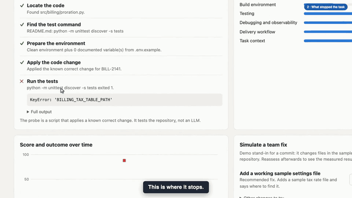

# AgentReady

Finds what stops AI coding agents from completing work on a repository, assigns
the gaps to the owning teams, and checks whether the fixes actually help.

The primary outcome is **task completion rate**. The readiness score is a
supporting signal, and a higher score alone proves nothing.

[](https://arunks2804.github.io/agentready/)

**▶ [Watch the narrated product demo (5½ min, 1080p, with sound)](https://arunks2804.github.io/agentready/)** · [download the MP4](docs/demo/agentready-demo.mp4). It is written for a non-technical audience. Plain-English slides explain the problem and what is simulated, then each step is shown live in the app with full captions. Every number spoken is read from the page while it records. The British voiceover is AI-generated (Piper, run locally).

📄 **Start here: [PRODUCT_BRIEF.md](PRODUCT_BRIEF.md)** covers the problem, the users, the product, the decisions and the scope. Evidence from a full run is in [docs/examples/SUMMARY.md](docs/examples/SUMMARY.md).

## Run

```bash
python3 -m pip install -r requirements.txt
python3 -m uvicorn app.main:app --port 8010
```

Open http://127.0.0.1:8010. Tests: `python3 -m pytest`.

## Demo path

1. **Overview:** 1 of 3 tasks finish at baseline.
2. **billing-service:** the task is blocked because the tests need a tax rate file that nothing points to.
3. Apply the recommended fix, *Add a working sample settings file*, then click **Reassess now**. The task finishes and the finding is verified.
4. **notifications-service:** three blockers appear one at a time as each recommended fix is applied.
5. **Reset demo** returns to baseline.

To see that a score is not proof, reset the demo and open **Other changes to try** on billing-service. *Add architecture overview* raises the score and the task stays blocked. *Name the setting only* passes the static check, yet the finding reopens because the task still fails.

## What is real and what is simulated

| Part | Status |
|---|---|
| Readiness checks on sample and registered repos | Real: reads files on disk |
| Probe task outcomes on sample repos | Mixed: billing-service's blocks are real test failures; notifications-service's three blocks are rule-based stops before any test runs |
| The probe's code change | Scripted: applies a known correct change, so it tests the repo and not an LLM |
| Team fixes in the demo | Simulated: stands in for a commit; the reassessment after it is real |
| Failed agent traces | Simulated fixtures, labelled in the UI and excluded from task completion |
| Sample repos, tickets and teams | Fictional |
| Time to remediate | Real timestamps, but demo-clock seconds rather than engineering time |

No real LLM agent has been run, so nothing here shows that an LLM's completion
rate improves. That is the next thing to test.

## Scripts first, AI where it is needed

Scripts handle facts: file checks, builds and tests, reruns, known failure signatures, routing and metrics. AI is needed where judgement is required or where agent behaviour is the thing being measured, and there are two separate roles. A **coding agent**, an existing tool, attempts real tasks. The **Gap Analysis Agent**, part of AgentReady, explains new failures, judges whether documentation is usable, and drafts fixes for review.

That split keeps cost down, because agents run on a sample while scripts screen every change. The saving is not measured yet. This prototype implements the script side only; both AI roles are planned. See [the brief](PRODUCT_BRIEF.md#scripts-first-ai-where-it-is-needed) for the full split.

## Reproduce the results and the demo

```bash
python3 scripts/run_full_loop.py
```

That rewrites `docs/examples/`. To re-record the video you also need ffmpeg and a Piper voice in `var/voices/`:

```bash
python3 -m pip install -r requirements-demo.txt
python3 -m playwright install chromium
python3 -m piper.download_voices --download-dir var/voices en_GB-cori-high
python3 scripts/record_demo.py
```

The recorder runs its own copy of the app on port 8019 and stops if the demo story does not hold.

## How verification works

A finding stays open while its check fails **or** while the measured task is
blocked on it. Teams can submit a fix, but only a reassessment can verify one.

## Limits

- Registered repositories get static checks only. Their code is never executed, so their task outcome is "not measured".
- Findings come only from static checks and probe runs. Traces link to existing findings and do not create new ones.
- Checks use file conventions and suit Python and common layouts best.
- The app has no authentication, so keep it bound to localhost. It rejects other hosts and cross-site writes.
- Traces uploaded through the API are always stored as Simulated, because they cannot be verified.
